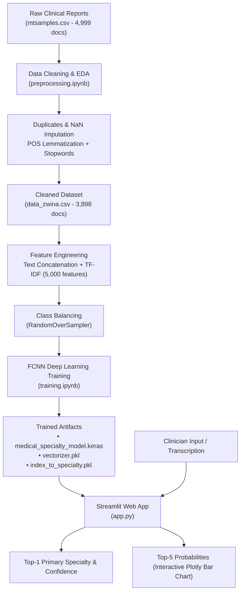

# 🩺 Medical Specialty Predictor (Classification Automatique de Rapports Médicaux)

[](https://www.python.org/)
[](https://www.tensorflow.org/)
[](https://streamlit.io/)
[](https://scikit-learn.org/)
[](http://www.fsb.univh2c.ma/)

> **Projet de Fin de Module (PFM) — Année Universitaire 2024–2025**  
> **Faculté des Sciences Ben M'Sick (FSBM), Université Hassan II de Casablanca**

---

## 📌 Table of Contents
- [Overview](#-overview)
- [Team & Academic Supervision](#-team--academic-supervision)
- [System Architecture](#-system-architecture)
- [Key Features](#-key-features)
- [Dataset & Preprocessing](#-dataset--preprocessing)
- [Model Architecture & Training](#-model-architecture--training)
- [Model Evaluation & Results](#-model-evaluation--results)
- [Streamlit Web Application](#-streamlit-web-application)
- [Supported Medical Specialties (39 Classes)](#-supported-medical-specialties-39-classes)
- [Project Structure](#-project-structure)
- [Installation & Quickstart](#-installation--quickstart)
- [Academic Deliverables](#-academic-deliverables)
- [Future Enhancements](#-future-enhancements)
- [References](#-references)

---

## 🌟 Overview

In modern healthcare institutions, clinicians generate substantial amounts of unstructured textual data every day—including consultation notes, surgical summaries, discharge letters, and diagnostic records. Manually categorizing and routing these records by clinical specialty is labor-intensive, time-consuming, and prone to human error.

**Medical Specialty Predictor** is an end-to-end Natural Language Processing (NLP) and Deep Learning system capable of automatically reading clinical narratives and classifying them into **39 distinct medical specialties**. The solution features an interactive, healthcare-themed **Streamlit web application** designed for real-time clinical note triage and decision-support assistance.

---

## 👥 Team & Academic Supervision

- **Student Researchers:**
  - **Badr MARTAJ**
  - **Rajae RAMI**
  - **Maroua KARROUM**
- **Academic Supervisors:**
  - **M. Oussama KAICH**
  - **M. El Habib BEN LAHMAR**
- **Institution:** Université Hassan II de Casablanca, Faculté des Sciences Ben M’Sick (FSBM).

---

## 🏗️ System Architecture



---

## ✨ Key Features

- **End-to-End NLP Pipeline:** Thorough text preprocessing with lowercasing, punctuation stripping, tokenization, stopword removal, and POS-guided lemmatization via NLTK.
- **Multimodal Text Feature Fusion:** Combines document `description`, `sample_name`, `keywords`, and `transcription` into a unified textual representation to maximize context.
- **39 Medical Specialties Supported:** Classifies broad clinical disciplines ranging from Cardiology and Orthopedics to Neurosurgery, Gastroenterology, and Dermatology.
- **Deep Neural Network Classifier:** 2-layer Fully Connected Neural Network (FCNN / MLP) with Dropout regularizations to prevent overfitting.
- **Class Balancing:** Addresses severe clinical class imbalance using `RandomOverSampler`.
- **Modern Healthcare Web UI:** Custom-styled Streamlit interface featuring:
  - Interactive transcription analysis with instant character counts.
  - Built-in sample clinical transcriptions for quick testing.
  - Searchable directory modal displaying all 39 medical categories.
  - Horizontal Plotly probability bar chart for Top-5 differential predictions.
  - Confidence scoring bands (High Confidence >80%, Moderate >60%, Manual Review Warning).

---

## 📊 Dataset & Preprocessing

- **Source:** Kaggle [Medical Transcriptions Dataset](https://www.kaggle.com/datasets/tboyle10/medicaltranscriptions) (`mtsamples.csv`).
- **Initial Volume:** 4,999 records across 40 specialty categories.
- **Exploratory Data Analysis (EDA) Insights:**
  - High skewness in class distributions (Surgery and Consultation records heavily dominate; rare specialties have <20 samples).
  - Skewed word counts: Most clinical notes span 100–400 words (median ~200), with rare records exceeding 1,000 words.
- **Data Cleaning (`preprocessing.ipynb`):**
  - Deduplication: Identified and dropped duplicate entries.
  - Missing Value Imputation: Handled 33 missing transcriptions; imputed empty keywords with specialty-specific modes or tagged as `unknown`.
  - Normalization: Retained alphanumeric characters, lowercase normalization.
  - Lemmatization: POS-tagged WordNet lemmatization.
  - Output Dataset: Saved as [`data_zwina.csv`](data_zwina.csv) (3,898 records, 39 specialties).

---

## 🧠 Model Architecture & Training

The classification engine relies on a **Fully Connected Neural Network (FCNN)** built with TensorFlow/Keras:

| Layer | Type | Specifications | Activation / Regularization |
| :--- | :--- | :--- | :--- |
| **Input** | `Input` | 5,000 features (TF-IDF unigrams & bigrams) | — |
| **Dense 1** | `Dense` | 512 units | `ReLU`, `Dropout(0.4)` |
| **Dense 2** | `Dense` | 256 units | `ReLU`, `Dropout(0.3)` |
| **Output** | `Dense` | 39 units (multi-class specialty distribution) | `Softmax` |

- **Total Trainable Parameters:** **2,701,863** (~10.8 MB).
- **Optimizer:** `Adam`
- **Loss Function:** `categorical_crossentropy`
- **Regularization & Callbacks:** `EarlyStopping(monitor='val_loss', patience=3, restore_best_weights=True)`.
- **Training Strategy:** Stratified 80/20 train/test split, batch size = 64, 10 epochs with validation tracking.

---

## 📈 Model Evaluation & Results

- **Validation Accuracy:** **~88.54%**
- **Test Set Accuracy:** **~87.36%**
- **Confusion Matrix:** Shows high diagonal consistency across specialties with distinctive vocabularies (e.g., Urology, Ophthalmology, Radiology).
- **Inference Speed:** Real-time classification (< 50ms per clinical note).

---

## 🖥️ Streamlit Web Application

The interactive web dashboard is implemented in [`app.py`](app.py):

```
+-----------------------------------------------------------------------------------+
|                           🩺 Medical Specialty Classifier                         |
|                 Advanced AI-powered classification of medical transcriptions     |
|                       [ 📋 View All 39 Medical Specialties ]                      |
+-----------------------------------------------------------------------------------+
|  [Sidebar]                  |  Clinical Transcription Input                       |
|  - Quick Start Guide        |  +-----------------------------------------------+  |
|  - Total Specialties: 39    |  | Paste clinical note, consultation report, or  |  |
|  - Load Demo Samples:       |  | surgical summary here...                      |  |
|    • Cardiology / Pulmonary |  +-----------------------------------------------+  |
|    • Surgery                |  [ 🗑️ Clear Text ]     [ 🔍 Analyze Transcription ] |
|    • Gastroenterology       |                                                     |
|    • Orthopedics            |  Prediction Results:                                |
|  - Session Counters         |  +-----------------------+ +---------------------+  |
|                             |  | 🩺 Primary Specialty  | | 🔮 Confidence Score |  |
|                             |  |    Gastroenterology   | |         76.5%       |  |
|                             |  +-----------------------+ +---------------------+  |
|                             |                                                     |
|                             |  Top 5 Predictions (Plotly Bar Chart)               |
|                             |  Gastroenterology       ■■■■■■■■■■■■■■■ 76.5%       |
|                             |  Surgery                ■■■ 12.1%                   |
|                             |  Internal Medicine      ■■ 6.4%                     |
|                             |  Consult / History      ■ 3.2%                      |
|                             |  General Medicine       ■ 1.8%                      |
+-----------------------------------------------------------------------------------+
```

---

## 📋 Supported Medical Specialties (39 Classes)

<details>
<summary><b>Click to expand the full list of 39 classified specialties</b></summary>

1. Allergy, Immunology
2. Bariatrics
3. Cardiovascular, Pulmonary
4. Chiropractic
5. Consult, History, Physical
6. Cosmetic, Plastic Surgery
7. Dentistry
8. Dermatology
9. Diets, Nutritions
10. Discharge Summary
11. Endocrinology
12. ENT - Otolaryngology
13. Emergency Room Reports
14. Gastroenterology
15. General Medicine
16. Hematology - Oncology
17. Hospice - Palliative Care
18. IME-QME-Work Comp etc.
19. Infectious Diseases
20. Lab Medicine - Pathology
21. Letters
22. Nephrology
23. Neurology
24. Neurosurgery
25. Obstetrics / Gynecology
26. Office Notes
27. Ophthalmology
28. Orthopedic
29. Pain Management
30. Pediatrics - Neonatal
31. Physical Medicine - Rehab
32. Podiatry
33. Psychiatry / Psychology
34. Radiology
35. Rheumatology
36. SOAP / Chart / Progress Notes
37. Sleep Medicine
38. Surgery
39. Urology

</details>

---

## 📂 Project Structure

```
projet_m3a_lfatayat/
│
├── Poster/
│   └── Classification automatique de rapports médicaux par spécialité.pdf  # Project defense poster
├── Rapport/
│   └── rapport_PFM.pdf                       # 20-page formal PFM academic report
│
├── app.py                                    # Streamlit web application & UI
├── requirements.txt                          # Project dependency specifications
├── .gitignore                                # Git ignore configurations
├── .gitattributes                            # Line normalization settings
│
├── preprocessing.ipynb                       # Data cleaning, EDA, tokenization, lemmatization
├── training.ipynb                            # Vectorization, FCNN training, evaluation, saving
├── prediction.ipynb                          # Quick notebook for inference testing
│
├── mtsamples.csv                             # Raw dataset from Kaggle (~5k rows)
├── data_zwina.csv                            # Cleaned & processed dataset (3,898 rows)
│
├── medical_specialty_model.keras             # Trained Keras model (native Keras format)
├── medical_specialty_model.h5                # Trained Keras model (legacy HDF5 format)
├── vectorizer.pkl                            # Fitted TF-IDF vectorizer (5,000 features)
├── index_to_specialty.pkl                    # Mapping from index (0-38) to specialty name
└── label_encoder.pkl                         # Label encoder artifact
```

---

## 🚀 Installation & Quickstart

### Prerequisites
- Python 3.10, 3.11, or 3.12
- Git

### 1. Clone the Repository
```bash
git clone https://github.com/NIJITSO/projet_m3a_lfatayat.git
cd projet_m3a_lfatayat
```

### 2. Create and Activate a Virtual Environment
```bash
# On Windows
python -m venv venv
.\venv\Scripts\activate

# On Linux / macOS
python3 -m venv venv
source venv/bin/activate
```

### 3. Install Dependencies
```bash
pip install -r requirements.txt
```

### 4. Launch the Streamlit Web Application
```bash
streamlit run app.py
```
Open your browser and navigate to `http://localhost:8501`.

### 5. Running Quick Python Inference
```python
import joblib
import re
import numpy as np
from tensorflow.keras.models import load_model

model = load_model("medical_specialty_model.keras")
vectorizer = joblib.load("vectorizer.pkl")
index_to_specialty = joblib.load("index_to_specialty.pkl")

def predict_specialty(text):
    clean = re.sub(r'[^a-z0-9\s]', '', text.lower())
    vec = vectorizer.transform([clean]).toarray()
    probs = model.predict(vec, verbose=0)
    idx = np.argmax(probs)
    return index_to_specialty[idx], float(probs[0][idx])

specialty, conf = predict_specialty("Patient scheduled for arthroscopic repair of anterior cruciate ligament.")
print(f"Predicted Specialty: {specialty} ({conf * 100:.2f}%)")
```

---

## 📄 Academic Deliverables

- 📘 **PFM Thesis Report:** Comprehensive 20-page document covering problem framing, state-of-the-art review, data curation, experimental methodology, and clinical validation. Located in [`Rapport/rapport_PFM.pdf`](Rapport/rapport_PFM.pdf).
- 🖼️ **Academic Defense Poster:** Visual overview detailing project objectives, data distributions, neural architecture, confusion matrix, and Streamlit UI. Located in [`Poster/Classification automatique de rapports médicaux par spécialité.pdf`](Poster/Classification%20automatique%20de%20rapports%20m%C3%A9dicaux%20par%20sp%C3%A9cialit%C3%A9.pdf).

---

## 🔮 Future Enhancements

- [ ] **Transformer Encoders:** Fine-tuning biomedical LLMs such as `ClinicalBERT`, `BioBERT`, or `PubMedBERT` for deeper contextual semantics and clinical entity recognition.
- [ ] **Medical Negation Handling:** Integration of NegEx / clinical rule systems to differentiate between confirmed conditions and negated symptoms (e.g., "no signs of myocardial infarction").
- [ ] **Multilingual Support:** Extending classification capabilities to French and Moroccan medical documents.
- [ ] **FHIR / EHR Integration:** Developing RESTful API endpoints compliant with Fast Healthcare Interoperability Resources (FHIR) to connect directly with Hospital Information Systems (HIS).

---

## 📚 References

1. Boyle, T. (2019). *Medical Transcriptions Dataset*. Kaggle. [Link](https://www.kaggle.com/datasets/tboyle10/medicaltranscriptions).
2. Bird, S., Klein, E., & Loper, E. (2009). *Natural Language Processing with Python*. O'Reilly Media.
3. Chollet, F. (2021). *Deep Learning with Python* (2nd ed.). Manning Publications.
